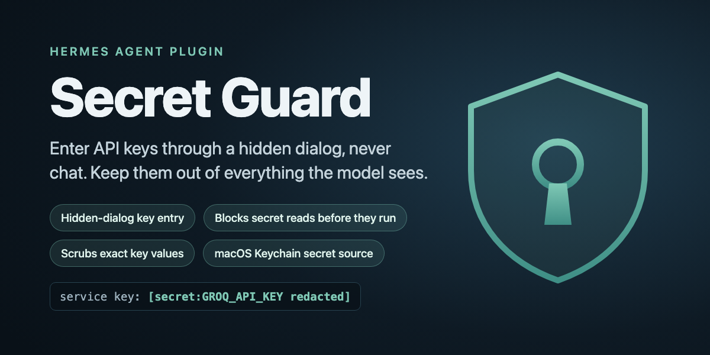

# Secret Guard

**Safe key entry and leak prevention for Hermes Agent.**

Agents need API keys. Today the easy way to give Hermes one is to paste it into chat, where it
lands in the transcript, the session store, memory and the model provider's logs. And once a key
is on the machine, one `printenv` from the agent, or one read of a `.env` file, puts it back in
front of a model.

Secret Guard closes both ends:

- **Keys come in through a hidden dialog, never chat.** Ask Hermes to add a key; a native macOS
  dialog takes it, the value goes straight into your keychain, and Hermes sees only a name, a
  fingerprint and a length. The `secret_request` tool has no value parameter, so there is nothing
  for the model to fill in.
- **Reads are blocked before they run.** A tool call whose command, code or path points at a
  secret file, runs a secrets helper or asks the keychain to print a value is refused, for
  built-in, plugin and MCP tools alike.
- **Exact key values are scrubbed** from tool results, terminal output and replies before the
  model sees them, even from commands no filename rule could predict.
- **A key pasted into chat is stopped before inference.** The turn ends before any model call, a
  placeholder is stored instead of the message, and you're told whether to rotate the key.
- **Keys reach your profiles through Hermes's own secret source API,** with bot tokens kept to the
  root profile so the multiplex gateway keeps working.

**Why a plugin and not a skill:** a skill can ask the agent to be careful. Only a plugin can refuse
a tool call before it executes, rewrite output before it reaches the model, and veto a turn before
inference. Secret Guard uses all three.

It is not a sandbox: an agent determined to transform a key before printing it can still get one
out. *Honest limits* below says exactly where the edges are.

## What it looks like

```
you:     add my Groq key
hermes:  [a "Secret Guard" dialog opens on your Mac; you paste the key and click Save]
         GROQ_API_KEY is stored in the keychain (fingerprint 3f9a…, 56 chars).

you:     run perl -ne 'print' notes.txt
hermes:  service key: [secret:GROQ_API_KEY redacted]

you:     show me what's in ~/.hermes/.env
hermes:  Secret Guard blocked that: it reads a secret-shaped file (.env).
```

Results against a real agent (Hermes 0.23.0, macOS) with a prefix-less canary key that Hermes's
built-in regexes don't recognise. The *With* column is measured by `tests/e2e_canary.sh`, which
also requires the baseline to leak; the other *Without* entries are Hermes's default behaviour.

| Attempt | Without Secret Guard | With Secret Guard |
|---|---|---|
| `perl` prints a file holding the key | key in the reply and 2 stored rows (measured) | `[secret:… redacted]`, 0 stored rows |
| read a `.env` file | runs | blocked before it runs |
| `execute_code` opens the `.env` file | runs | blocked before it runs |
| `security find-generic-password -w` | runs | blocked |
| key pasted into chat | sent to the model | turn stopped, nothing stored |

## How it differs from other secret plugins

Hermes already has good places to *keep* keys: built-in Bitwarden and 1Password sources, and
community sources such as `pass-secrets` and `hermes-dpapi-secrets`. `redaction-pack` adds masks
for known key formats. Secret Guard is the piece around them: getting a key in without chat,
refusing the calls that would read it back, and scrubbing your own exact values, including keys
with no recognisable prefix.

## Install

```
hermes plugins install ChasClogston/hermes-secret-guard
hermes plugins enable secret-guard --no-allow-tool-override
hermes tools enable secret_guard          # if your profile restricts toolsets
```

Then turn on the key source in that profile's `config.yaml` (Hermes applies a secret source only
when this is set):

```yaml
secrets:
  secret_guard:
    enabled: true
```

Plugins are per profile; repeat in each profile that should be guarded. `hermes secret doctor`
lists every profile and says which ones still need a step.

## Commands

| Command | Does |
|---|---|
| `hermes secret add ENV_VAR [--scope all\|default-only]` | Dialog entry. Prints name, fingerprint, length. |
| `hermes secret list` | Names, scopes, fingerprints. Never values. |
| `hermes secret verify ENV_VAR` | Checks the keychain item and the value Hermes resolved, by fingerprint. |
| `hermes secret remove ENV_VAR --yes` | Deletes the keychain item and registry entry; keeps the entry if the delete fails or a replace is pending. |
| `hermes secret recover ENV_VAR [--yes] [--discard]` | Finishes (or with `--discard`, cancels) an interrupted replace, without re-entering the key. |
| `hermes secret import SCRIPT` | Registers keys named in an existing `emit "service" "ENV"` keychain helper. Reads names only; never runs it. |
| `hermes secret doctor` | Read-only health check of every profile. Exit 1 on problems. |
| `hermes secret inventory` | Static inventory of every Hermes home: reads config only. Exit 1 if incomplete. |

## Inventory: where Secret Guard is, home by home

```bash
hermes secret inventory                   # inside a Hermes that has the plugin
python3 inventory.py --root ~/.hermes     # from a clone, with no Hermes and no plugin installed
```

A static, read-only report. For each Hermes home it reads two files, `config.yaml` and the
manifest at `<home>/plugins/secret-guard/plugin.yaml`, and prints one of six states:

| State | Meaning |
|---|---|
| `absent` | No plugin files in this home's user plugin directory. |
| `disabled` | Plugin files are present there; this home's config does not list the plugin, or lists it as disabled. |
| `configured` | Plugin files are present there and this home's config lists the plugin. |
| `unsupported` | Plugin files are present on a host the plugin does not load on (anything but macOS). |
| `unreadable` | A file or folder needed for the answer could not be read. |
| `unknown` | A file could not be parsed, a relevant field is malformed, or a recognised home has no `config.yaml`. |

**No state means "protected".** `configured` describes files on disk. Whether a running Hermes
has the guard loaded and enforcing is not tested, and every row says `runtime: not tested`.

**One location is inspected:** the user plugin directory of each home. Hermes can also load a
plugin from its bundled plugins, from an opt-in project folder (`./.hermes/plugins`) and from a
pip package, and `HERMES_SAFE_MODE` turns plugins off. None of that is inspected. `absent`
means absent from the user plugin directory, not "no possible installation".

**Which folders count as homes.** The root itself, and each folder under `profiles/` that
Hermes itself would list: a valid profile id (`a-z`, `0-9`, `_`, `-`, up to 64 characters, not
`default`), at least one identity marker (`config.yaml`, `.env`, `SOUL.md`, `profile.yaml`,
`auth.json`, `state.db`), and no tombstone under `profiles/.deleted/`. These rules were read
from Hermes's source at commit `3b4215785882` (0.23); the report names that version. Markers
are checked for existence only and never opened. Everything else under `profiles/` is counted
by kind: `not-a-profile`, `deleted`, or `ambiguous` (it looks like a home, but Hermes would not
list it; check it by hand). A tombstone counts as Hermes counts it, following symlinks: a dangling tombstone link deletes nothing, while a dangling marker link still marks a home. A tombstone that cannot be examined makes the row `unreadable`, never deleted. A home reached twice is counted once. Plugins are per home:
nothing is inherited from the root profile.

**When the inventory is incomplete (exit code 1).** A root you asked for is missing, is not a
folder or cannot be listed; a home is `unreadable` or `unknown`; a folder has more entries than
the tool will list; or there is no YAML reader. An incomplete run never reads as a clean one.

**Complete is not the same as fully accounted for.** `complete` means the stated rules were applied to everything in scope. Ambiguous entries are counted separately as `needs_attention`, in the text and in JSON, and still need a person to resolve them. The Hermes commit shown is a compatibility baseline: the installed Hermes is not detected, and a change in its rules needs this tool to be updated.

**Malformed never becomes positive.** `plugins.enabled` and `plugins.disabled` must each be a
list of text (or missing, or empty). A scalar, a mapping or a non-text member makes the home
`unknown`, even where Hermes itself would ignore the bad field, because a mistyped disable is
exactly what an inventory should surface. The manifest's name, version, hook list and platform
list are checked the same way. A manifest with no hook list is a note, not an error.

**Reads are bounded.** Each file is opened without blocking and must be a regular file once
open, so a FIFO, device or folder put in its place is refused instead of read. Symlinks are
followed, as Hermes follows them. Reads stop at a size cap, and text must be valid UTF-8.

**What is printed.** By default no name or path from the file system: homes are `home-1`,
`home-2`, and skipped entries are counted by kind. `--names` adds profile names and skipped
entry names; `--paths` adds full paths. Both can be sensitive. No configuration value is ever
printed, and a manifest version is shown only if it has the form of a version number. `--json`
gives the same report as data. `--expect-version` and `--expect-commit` add a note to every
copy that differs. `--root` (repeatable) adds homes outside the default root.

**What it does not do.** Run as a script, it imports nothing from the plugin, runs no
subprocess, opens no socket and writes nothing. `hermes secret inventory` reaches the same code
through the plugin's command module, which Hermes has already loaded together with the
plugin's keychain code; the inventory calls none of it. It does not install or repair.

It needs a YAML reader: Hermes's bundled one, or PyYAML. With neither, every home is
`unknown`. `hermes secret doctor` is a different tool: it runs inside one profile and does
resolve keys, to check that they arrive.

## History scan: is secret-shaped text sitting in a home's text records?

```bash
python3 history_scan.py --home ~/.hermes/profiles/<one-profile>     # you, at a terminal
```

A summary-only, read-only scan of **one** Hermes home. It is a standalone script: not a
Hermes command, not an agent tool, not a hook, never scheduled. `--home` is required and has
no default.

**What it covers (contract `text-v1`, Hermes 0.23):** the direct entries of two folders.

| Kind | Files |
|---|---|
| transcripts | `sessions/*.jsonl`, `sessions/*.json` |
| logs | `logs/*.log`, `logs/*.log.N` |

**What it does not cover, and says so on every run:** the session database `state.db`, where
Hermes keeps most conversation history; every other file and folder in the home and every
subfolder of the two above; binary formats, archives and compressed files; secrets in any
encoded or transformed form; assignments to secret-looking names; generic high-entropy
strings; and values registered with Secret Guard (that would need the keychain, which this
tool never touches). A finished run is a finished scan of that text scope only. **Zero
findings does not show the home holds no secrets.**

**What it looks for:** three fixed categories.

| Category | Matches | Distinct count |
|---|---|---|
| `private-key-header` | a PEM `-----BEGIN ... PRIVATE KEY-----` line | no: every key of a type shares the header, so only occurrences are counted |
| `provider-key-prefix` | seven key shapes: `sk-ant-`, `sk-` / `sk-proj-`, GitHub `ghp_`-family and `github_pat_`, Slack `xox?-`, AWS `AKIA`, Google `AIza` | yes |
| `bot-token-shape` | digits, a colon, 35 token characters | yes |

The shapes were chosen by the author from the public look of these keys. They are not vendor
guarantees: a key of another length or alphabet is missed, and a look-alike string is counted.
Every full match is counted as a candidate. Nothing is left out for looking like a
placeholder. A match whose last 24 characters hold fewer than 8 different characters is also
counted under "low-variety"; that is an annotation, not an exclusion, and it does not say the
value is harmless. Files are chosen by name and read as bytes, so a binary file with a
covered name is scanned like any other; nothing is decoded or unpacked.

**What it prints:** counters and fixed labels. Per kind: files inspected, bytes read,
occurrences by category, how many of those are low-variety, and file notes under fixed labels. Then
totals with distinct candidates, run notes, and whether the text scope finished. No source text
or identifiers are emitted: no file name, path, offset, snippet, digest or error message.
Distinct candidates are counted with a keyed digest whose key exists only in memory for the
run. It writes no file, so there is no report to protect or clean up.

**How it reads:** the home you name is followed if it is a link, because you chose it. Below
it nothing is: the tool walks by directory handle and opens each entry without following
symlinks and without blocking, then checks the open handle is a regular file. Work is bounded
by entries listed, files opened, bytes per file and in total, distinct candidates remembered
(200,000 per category) and a time budget. The byte limits are exact: a read is never larger
than both limits still allow, and there is no look-ahead read. Anything cut short is counted
under a fixed label and the result is "NOT FINISHED", never a clean one; its counts are
partial, and a token cut by a limit can be counted in shortened form or missed. Cancelling or
an internal error gives the same.

**Limits.**
- *Same-user limit.* The tool refuses to run unless attached to a terminal. That is friction,
  not proof that a person started it: any process running as you can start the script or
  imitate a terminal. Because it prints only counters, that is what such a process could learn.
- *Scope means directory entries.* A hard-linked file shares its content with a file elsewhere;
  it is scanned and counted as `hard_linked`. A folder renamed after it was opened is still
  read through the open handle.
- *The time budget is cooperative.* It is checked while listing, before and after each open,
  between bounded reads and before the scope is called finished. It cannot interrupt a call
  the operating system has stalled.
- *No snapshot.* A file that changes while it is read is counted as `changed_during_scan`.
  Nothing claims a point-in-time view of a live history.

`python tests/test_history_scan.py` runs on synthetic homes with synthetic keys.

## How keys reach your profiles

Secret Guard is a Hermes **secret source** (`ctx.register_secret_source`), the same mechanism as
Hermes's Bitwarden and 1Password integrations. At startup Hermes asks it for each profile's keys and
tells it which profile is asking. Values are read from the keychain then; the plugin's registry
(`<hermes root>/secret_guard/registry.json`) holds only names, scopes and fingerprints.

Each secret has a scope:

- `all`: every profile gets it.
- `default-only`: only the root profile. Telegram, Discord and Slack bot tokens are forced to
  this scope. If a second profile resolved the same bot credential, the multiplex gateway would
  refuse to multiplex and silently fall back to standalone.

If you already feed keys through `secrets.command` or another source, both can run while you
migrate: Hermes gives each variable to the first source that claims it and logs a warning instead
of overwriting. `hermes secret doctor` lists any variable your old source still supplies.

## Managing keys safely

- **Replacing a key is deliberately narrow.** `hermes secret add` replaces only a key already
  registered to that variable, with the same keychain item, and keeps its scope. It refuses,
  before changing anything, to overwrite an existing keychain item that isn't registered (register
  it with `import` first) or to change scope (remove and add it again).
- **An interrupted replace** (a crash or keychain error mid-way) is recoverable without re-entering
  the key. Before changing anything, the plugin records the new key's fingerprint as pending; it
  then writes a verified recovery copy named `<service>.sg-staging`. `hermes secret recover
  ENV_VAR` finishes the replace (only from a copy that matches the pending record), and
  `recover --discard` cancels it. While one is pending, `verify` and `doctor` say so (even if the
  main item is missing), and a new replace or `remove` of that key is refused.
- **Changes wait at most 30 seconds for each other.** All changes share one lock; if another is
  in progress you get a "busy" message rather than a hang. The dialog runs before the lock.

## The three layers

1. **Path gate** (`pre_tool_call`, fails closed). Inspects every tool call's arguments by name, at
   any nesting depth: commands (`command`, `cmd`, `script`), inline code (`code`, `js`,
   `expression`) and paths (`path`, `file_path`, `paths`, `image_path`, …). It refuses a reader
   (`cat`, `grep`, `python -c`, `perl`, `cp`, …) or inline code pointed at a secret-shaped file
   (`*.env`, `*token*`, `*secret*`, `*credential*`, `*.pem`, `id_rsa`, `auth.json`, Hermes
   `config.yaml`), running any secrets helper, `security find-*-password -w/-g`, `security
   dump-keychain`, a bare `env`/`printenv`, and `openclaw mcp show` (prints stored headers unmasked).
   Since 1.1 it also refuses reads that reach such a file without naming it: a content search,
   `grep -r`, `rg`, `tar`, `zip`, `cp -r`, `find -exec` or `xargs` over a folder that holds one; a
   shell glob that matches one; a reader fed by `$(...)` or backticks; a `file://` address;
   `printenv NAME` or `echo $NAME` for a guarded variable; and `set`, `export -p` or printing
   `os.environ`. The same checks apply inside `sh -c '...'`, `bash -lc`, `eval` and command
   substitutions, up to three levels deep. A blocked folder read tells the agent to name the
   files it needs. A folder that is too large, or cannot be listed, is refused, not passed.
2. **Value redaction.** Every registered value is pushed into Hermes's own model-egress scrub, the
   same exact-value registry Hermes uses for browser-vault passwords. That registry applies even
   when `security.redact_secrets` is off. Backup `transform_*` hooks scrub tool results, terminal
   output and replies too; if a backup hook itself fails, it withholds the output instead of
   passing it through. Since 1.1 these hooks also redact each value's base64 (any alignment, both
   alphabets, wrapped or not, for every accepted value of 8 bytes or more), hex and
   percent-encoded forms.
3. **Inbound block** (`pre_llm_call`). An exact registered value, or a string shaped like a known
   key (`sk-`, `ghp_`, `xoxb-`, `AKIA`, `AIza`, Telegram bot tokens, …), stops the turn before any
   inference.

## Disclosures

What Secret Guard does on your machine, so you can decide before installing:

- **No network calls by the plugin.** No telemetry. (Hermes itself sends each resolved key to the service it belongs to.)
- **Shell commands.** `/usr/bin/security` (create, read and delete the keychain items you
  register with Secret Guard) and `/usr/bin/osascript` (the hidden-input dialog). The dialog runs only from
  `hermes secret add` or the `secret_request` tool when you ask Hermes to add a key.
- **Stored credentials.** Keys you enter are stored in your login keychain as generic passwords
  named `hermes-<env-var>`. The registry (`<hermes root>/secret_guard/registry.json`, mode 600)
  holds names, scopes and SHA-256 fingerprints, never values. While a replace is in progress it
  also holds the new key's fingerprint as a pending record, and the keychain holds a recovery copy
  named `<service>.sg-staging`; both are removed when the replace completes or is cancelled.
- **Keychain access.** Items are created with `-T /usr/bin/security`, so Hermes's secret source can
  read them at startup without a prompt. The trade-off: any process running as your user can also
  read them with `security find-generic-password -w`, without a prompt, which is the same exposure as
  a keychain `secrets.command` helper. A per-read keychain prompt would close that, but would hang
  cron and gateway runs.
- **Credential reads.** As a Hermes secret source, the plugin reads the keychain items you
  registered (entered through Secret Guard, or existing items you named with `import`) at startup and hands them to Hermes, which applies them per profile. Inside the agent,
  redaction gets values only through Hermes's `get_secret()`. The `hermes secret` CLI reads the
  same items to confirm a write and for `verify`, `doctor` and `import` (fingerprints only).
  `import` reads the names in a helper script you point it at; it never runs the script.
- **No config edits.** The plugin never writes your `config.yaml`; you add the
  `secrets.secret_guard` block yourself.
- **Blocking.** The `pre_tool_call` hook refuses some tool calls and the `pre_llm_call` hook some
  messages (see *The three layers*). Both fail closed: if a check errors, the call or turn is refused.
- **Unattended runs.** The dialog gives up after 5 minutes and the tool returns a plain error, so
  cron and gateway runs never hang on it. The secret source never prompts.
- **No background processes.**

## Honest limits

Secret Guard reduces exposure. It is not a sandbox and it does not certify anything.

- **Exact values and three encodings are scrubbed.** The plugin's transform hooks redact a key
  verbatim and in base64, hex and percent-encoded form. A key that is compressed, encrypted,
  reversed, upper-cased, spaced out, split across two outputs or partly echoed is not recognised.
  Hermes's own model-egress scrub still matches the exact value only. `xxd` and `hexdump` output
  with offsets and column groups is not matched; `xxd -p` is. Redaction is the safety net; the
  path gate and key entry outside chat are what keep keys from being read in the first place.
- **Folder reads are checked by file name, within limits.** One tool call gets one work budget
  for all its folder scans and glob expansions: 20,000 entries and 12 levels, plus a two-second
  budget that is cooperative (checked between folder listings; it cannot interrupt one slow
  filesystem call). Past that, or when a folder cannot be listed, the call is blocked. Symlinked
  folders are not followed, so `grep -R`, `rg -L` or `cp -L` can read further than the scan
  looked. A secret in an ordinarily named file is not seen.
- **Two deliberate reductions in folder-scan coverage.** A fixed list of tokenizer data files
  (`tokenizer.json`, `tokenizer_config.json`, `tokenizer.model`, `special_tokens_map.json`,
  `added_tokens.json`) and compiled Python (`*.pyc`, `*.pyo`) do not block a folder search. That
  is a noise trade, not proof those files are harmless: bytecode can embed a credential. A direct
  read of any of them is still blocked. Placeholder env files (`.env.example` and the like) are
  not exempt, so a recursive search of a repository that has one is refused; search a subfolder.
- **Whole-repository searches are often refused.** Name patterns also match public material such
  as `cacert.pem`. This is the cost of blocking by file name.
- **The scan is at least as wide as the tool, never narrower by assumption.** Every folder is
  scanned in full for `grep -r`, `tar`, `zip`, `cp -r`, `search_files`, `rg` and `ag`, including
  `node_modules` and virtual environments: ignore files are not read, so `rg` may be refused for
  a file it would in fact skip. The one modelled difference is dotfiles, which `rg` and `ag` skip
  unless `--hidden`, `-uu` or a `--glob` is given; a config file or alias that changes that is not
  seen. A search tool's file filter is honoured only when it can be modelled exactly (`*.py`,
  `src/**/*.py`); exclusions, brace patterns and character classes are ignored, which can only
  block more.
- **The scan uses the folder Hermes runs in** when a command gives a relative path. A tool with
  its own working folder, a remote backend or a container may be reading somewhere the scan did
  not look. This is a real gap, not a formality.
- **A secret file named without a folder is recognised by name, with one exception.** `rev
  prod.env`, `tr a b < prod.env`, `mv prod.env x.txt` and `F=prod.env` are refused for any
  program, because names like `prod.env` and `id_rsa` can only be files. Names that are also
  ordinary words (`credentials`, `token`, `secret`) are refused for the listed reader programs
  always, and for other programs only when such a file exists in a folder the command line
  may be using. In a shell that kept its folder from an
  earlier call, `rev credentials` is therefore not caught.
- **A folder change inside one command line never removes a folder from the check.** Nothing
  the gate can see proves that a `cd` ran and worked: it may sit in a branch that is not taken,
  its redirection may fail, the target may be unreadable. So every `cd` target is added as a
  candidate and the earlier folders stay; later commands are checked under every candidate, and
  a block under any of them blocks. The one narrowing is the AND-list: in `cd X && cmd`, `cmd`
  runs only if that `cd` ran and succeeded, so `cmd` is checked from `X` alone, for as long as
  the `&&` run lasts. It applies only to the bare form `cd X` (no `!`, keyword, option or
  redirection, not piped, not after `||`) and not on a line that redefines `cd` or sets
  `CDPATH`. The cost: `cd X; grep -r word .` and `cd X || exit; grep -r word .` are refused when
  the starting folder holds a secret file; write `cd X && grep -r word .`. More than eight
  candidates refuses the line. A folder named at run time (`cd "$DIR"`), an inherited `CDPATH`,
  a `cd` redefined outside the line, and a folder change made in an earlier call cannot be
  followed.
- **Command parsing is a small grammar, not a shell.** Quotes, `;`, `|`, `&&`, `$(...)`,
  backticks, `sh -c` and `eval` are handled. Here-documents, aliases, functions, variables holding
  command names and scripts on disk are not. Whether a `grep` call is recursive, and
  which folders it names, are read from the raw arguments, so a misread option can only add
  scanning. An option the tables do not know, or one whose value is optional in some `grep`
  builds, makes the call "not understood": the working folder is then scanned as well.
- **Some ordinary commands are now refused.** `cat $(...)`, `find . -exec grep ...`,
  `sh -c "$CMD"` and `grep -r` in a project that keeps a `.env` file are blocked; name the files
  or a subfolder instead. `rg` skips dotfiles by default, so a hidden `.env` does not block it
  unless `--hidden` or `-uu` is used.
- **Using a guarded variable is allowed; printing it is not.** `curl -H "Authorization: Bearer
  $KEY"` runs. `echo $KEY` is blocked. A script that prints the variable some other way is caught
  only by redaction.
- **What it can't see:** logging done by MCP servers or child processes outside Hermes; images and
  screenshots; backups taken before a value was scrubbed. The plugin makes no network calls, but
  Hermes sends resolved keys to the services they belong to, as it does for any secret source.
- **Shared redaction capacity.** Hermes's exact-value registry holds 64 values per profile, shared
  with browser-vault passwords. Secret Guard re-registers its keys on every turn, and its own
  transform hooks scrub with no cap, so an evicted key is still caught there.
- **Transform order.** When several plugins rewrite the same tool result, Hermes keeps the first
  rewrite. Hermes's own redaction, which carries Secret Guard's registered values, still runs on
  terminal output after the transform hooks and inside the file and MCP tool handlers. A tool whose
  output skips core redaction relies on whichever plugin's rewrite wins.
- **Argument names decide what the gate checks:** `command`, `code`, `script`, `path`,
  `file_path`, `paths` and similar. A tool that hides a file path or a shell command under another
  argument name is not inspected.
- **The path gate matches patterns.** It will block some harmless files (`tokens.txt`,
  `secret-santa.log`) and can be routed around, for example by building a filename at run time.
- **A key pasted into a messaging app has already left your machine.** Secret Guard keeps it from
  the model and the session store; rotate it anyway.
- **The dialog appears on the Mac Hermes runs on,** not on your phone, and can't show while the
  Mac is locked or asleep. From Telegram, Hermes tells you this before it asks.
- **A new key reaches other profiles at their next start.** In the session where you enter it,
  the plugin checks that Hermes's redactor actually removes that key and reports whether it does.
  Because Hermes's registry holds 64 values, a later registration can evict it; the plugin's own
  transform hooks still scrub it from tool results, terminal output and replies. Other running
  sessions pick it up when they restart.
- **Hermes skips plugin `pre_llm_call` hooks for sessions with persistence disabled,** so the
  paste block does not run there; the path gate and redaction still do.
- **Large or deeply nested tool arguments are refused, not skipped.** The gate inspects up to 12
  levels, 5,000 values and 2 million characters of command, code and path fields per call; a call
  beyond that is blocked. This can block unusually large legitimate calls.
- **The end-to-end test checks replies, the session store and logs,** and needs positive evidence
  for each case (a redaction label, or a block event for that attempt in the logs). It does not
  capture the exact payload sent to the model provider; no recording-provider test exists yet.
- **Keychain items made by other tools** may need an access approval the first time Secret Guard
  reads them; the source never prompts, so such an item is skipped (with a warning). Register it
  with `hermes secret import`, then replace its value with `hermes secret add`.
- **macOS only** in this version (Keychain + `osascript`). Values with whitespace, quotes or
  backslashes, or longer than about 3,900 characters, are refused; `security -i` can't carry them.
- Value redaction uses `agent.redact.register_vault_redaction_value` (to register keys) and
  `redact_registered_vault_values` (to confirm a just-entered key is covered), module functions rather
  than a documented plugin API (`hermes plugins validate` warns on both). If an update removes them,
  the plugin's own `transform_*` hooks still scrub tool results, terminal output and replies, and
  `doctor` reports the change. `hermes secret doctor` also reads each profile's `config.yaml` with
  Hermes's bundled `hermes_yaml.safe_load` (flagged by the same check), because Hermes does not ship
  PyYAML.

## Tests

```
cd <plugin folder>
HA=$(hermes --version | awk -F': ' '/Install directory/ {print $2}')   # your hermes-agent checkout
PYTHONPATH=$HA $HA/venv/bin/python tests/test_guard.py
```

Self-contained: a throwaway `HERMES_HOME`, a throwaway keychain and random canaries, removed at
the end. 165 checks: a block case and an allow case for every gate rule, fault injection for every
keychain and registry failure path, and assertions of the documented limits (so this README cannot
quietly overclaim).

`python tests/test_inventory.py` covers the inventory on synthetic homes: every state; Hermes's profile rules (each identity marker, invalid ids, tombstones, duplicates); a requested root that is missing or unreadable; malformed lists and manifest fields; FIFOs, devices and folders in place of files; size and count limits; and checks that nothing on disk changes, no marker file is opened and no name, path or configuration value is printed by default. It needs PyYAML and nothing else.

`python tests/test_gate.py` needs no Hermes and no keychain, and runs on any platform. It holds the
1.1 matrix: named secret files, folder-wide reads, globs, command substitution, environment reads,
`file://` addresses, the ordinary commands that must keep working, the encoded forms that are
redacted, and the known limits that are not. It also holds a regression for each finding of the
two independent reviews of the 1.1 candidates, and differential tests that really run the
installed `grep` and ripgrep in the synthetic tree: whenever the tool prints the synthetic value,
the gate must have blocked that command or search filter.

`tests/e2e_canary.sh` runs the same attacks against a real Hermes agent in a throwaway home and
throwaway keychain, and requires positive evidence for each result. See the script header for setup.

## Origin

Built for the Hermes Agent Plugin Hackathon (November 2026) from a working setup on two production
Macs: a hidden-dialog keychain intake tool, keychain-backed `secrets.command` helpers, and a shell
guard written after real key exposures. Secret Guard moves those into Hermes, where the hook system
closes gaps a shell guard can't reach.

## License

MIT. See [LICENSE](LICENSE).
